# U60Pro-OpenUI

[简体中文](README.md) | [繁體中文](README.zh-TW.md) | English

A third-party interface for the **ZTE U60 Pro (MU5250) on CN B31 firmware**: a web
dashboard and a touchscreen menu (DevUI) that add Clash / WireGuard / Tailscale proxies,
Wi-Fi relay, eSIM management, Wi-Fi client control and more on top of the stock
firmware. The main installer requires the prerequisites below; this is not a
claim of current clean-stock end-to-end qualification.

This repository is a fork of [acloudpeng/U60Pro-OpenUI](https://github.com/acloudpeng/U60Pro-OpenUI)
and continues [MU5250-OpenUI](https://github.com/dklasens/MU5250-OpenUI) and the work
listed under [Acknowledgements](#acknowledgements).

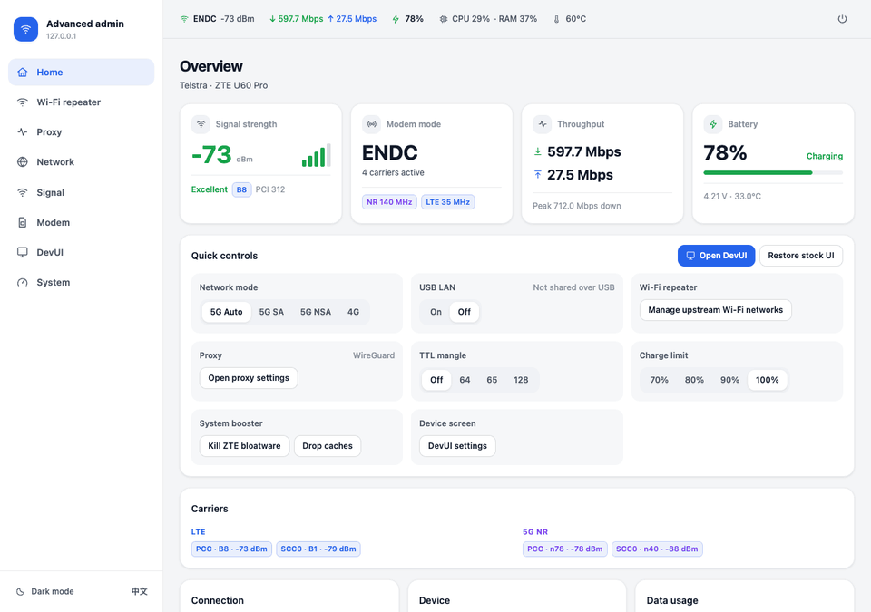

| Service | Address |
| --- | --- |
| Web dashboard | `http://192.168.0.1:8080/` |
| Authenticated API | `http://192.168.0.1:9090/` |
| SSH (key only) | `ssh -p 2222 root@192.168.0.1` |

> [!WARNING]
> Tested only on `MU5250_HW1.0` with `CN_ZTE_MU5250V1.0.0B31`. Installing enables ADB,
> turns off firmware auto-update and changes the device's startup script. Read the
> [safety notes](docs/SAFETY.md) first.

## One-command install

You need a Mac or Linux computer. **Locked B31 first install requires a USB DATA
cable and network access to the router** (Wi-Fi is useful for the network path);
Wi-Fi alone is insufficient. Existing root-SSH updates may use Wi-Fi only.

**Before downloading installation payloads**, obtain the router admin password
and the externally supplied backup-key suffix. This repository does not provide
it. Ask the [support channel](https://github.com/wgltony/U60Pro-OpenUI/issues) for
current acquisition guidance without posting suffixes or backups. Stop if unavailable.
Simple `strings` extraction does not work for known B31; offline tools do not obtain it.

```bash
git clone https://github.com/wgltony/U60Pro-OpenUI.git
cd U60Pro-OpenUI
bash install.sh --dry-run     # no device writes; downloads and creates local material
bash install.sh               # install; add --with-tailscale for Tailscale
```

The script checks the tools on your computer, downloads and verifies this repository's
release, enables ADB when the device is still locked (this needs the router admin
password and the backup-key suffix), then installs everything below in one deployment
with snapshots and attempted failure recovery. Step by step, with troubleshooting: the
[install guide](docs/INSTALL.md).

Before a locked first-install restore, interactive runs require `YES` to confirm
the USB DATA cable is attached to this computer; noninteractive runs require an
explicit `--acknowledge-usb`. An empty `adb devices` list is not proof of a cable.
Use `--adb-serial` when selecting among devices; waiting and deployment keep that
selection.

To update later: `bash install.sh --update` (keeps your password, skips unchanged parts).

## Screenshots

All screenshots come from the repository's demo data (`web-app/tools/mock_agent.py` and
the touchscreen preview build); none show a real device.

### Web dashboard

| | |
| --- | --- |
| 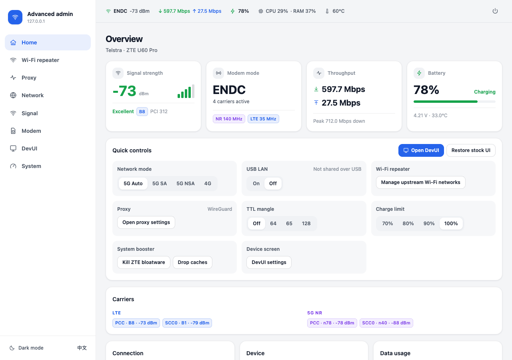<br>**Home**: signal, speed, battery, carriers and quick controls | 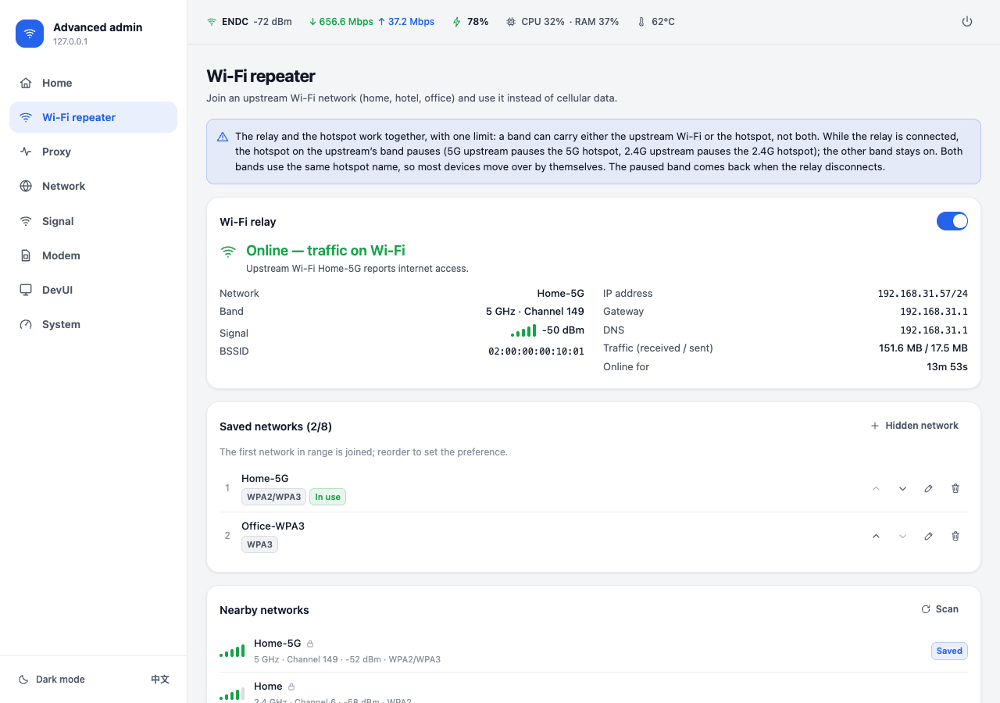<br>**Wi-Fi relay**: join an upstream Wi-Fi, save several networks, scan nearby ones |
| 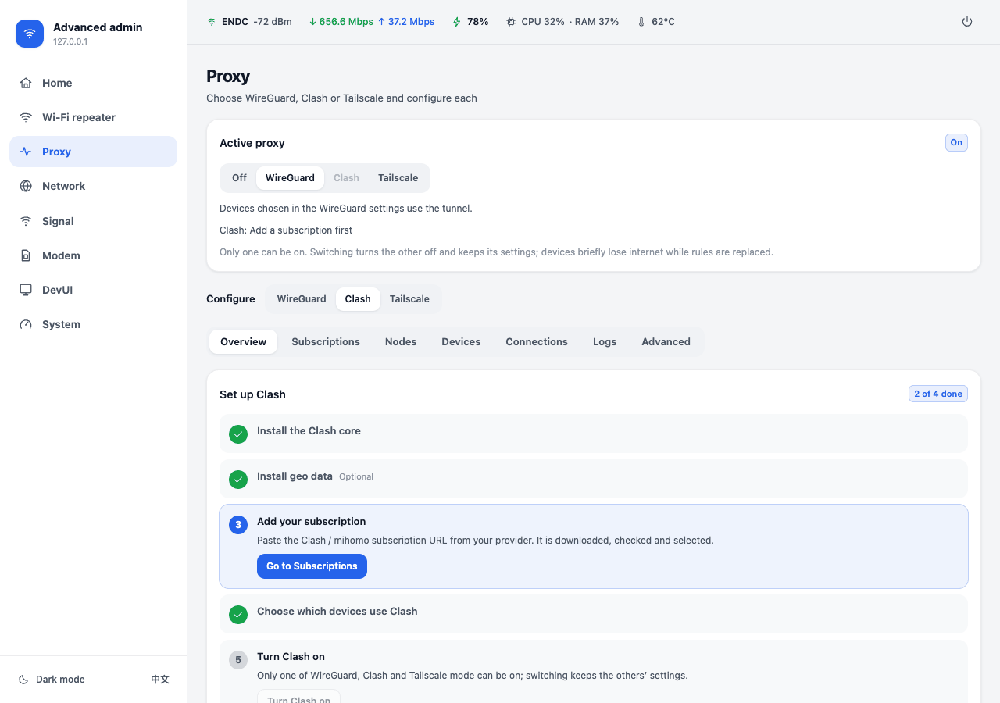<br>**Clash**: setup guide, subscriptions, nodes, per-device routing | 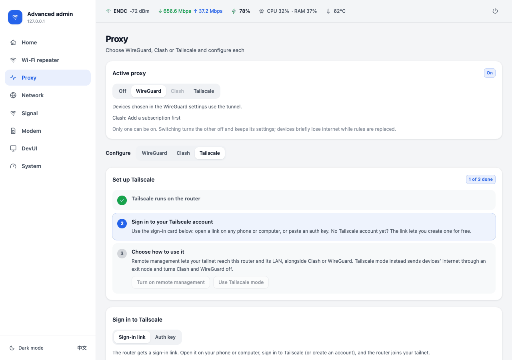<br>**Tailscale**: sign in on the page, exit nodes, remote management |
| 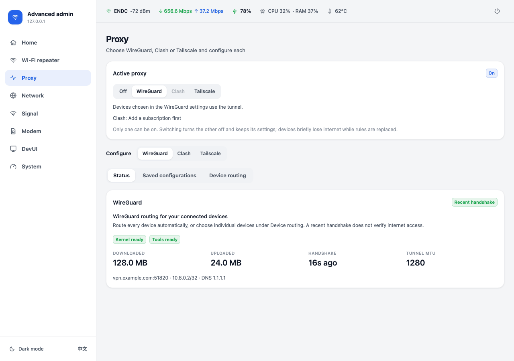<br>**WireGuard**: import configurations, per-device routing, tunnel status | 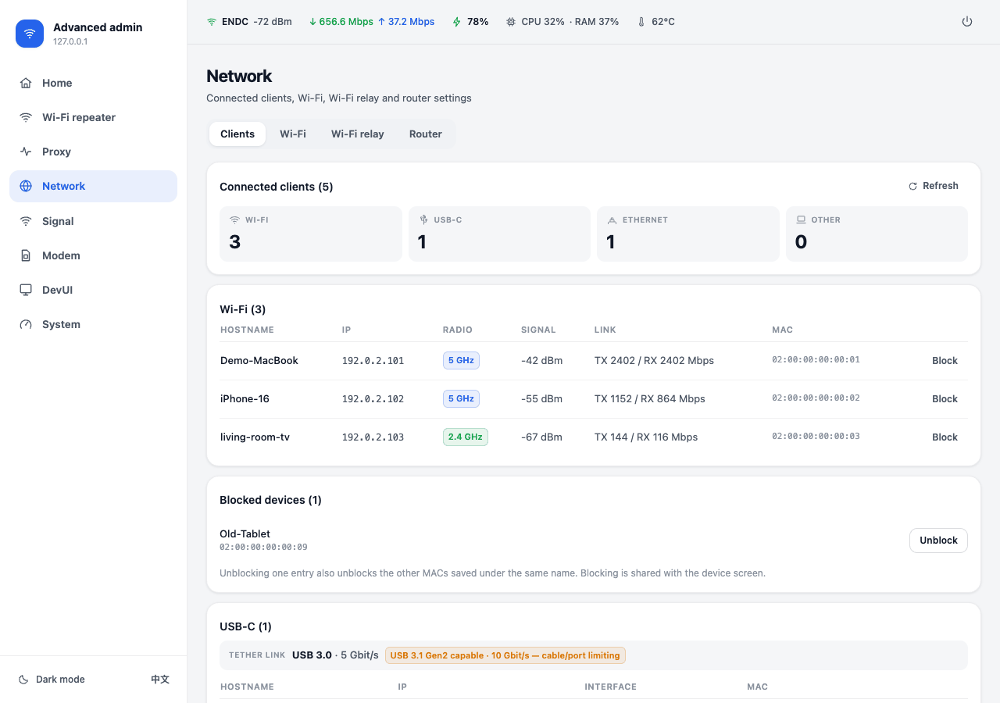<br>**Clients**: Wi-Fi, USB and Ethernet devices; block and unblock |
| 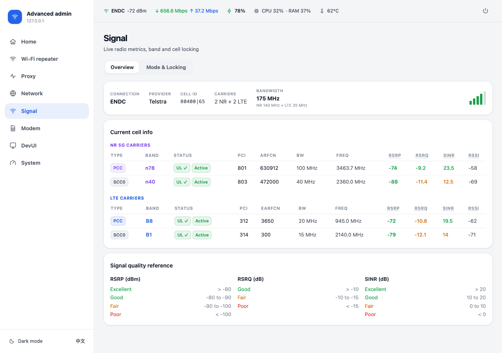<br>**Signal**: 5G / LTE carriers, cell details, band and cell locks | 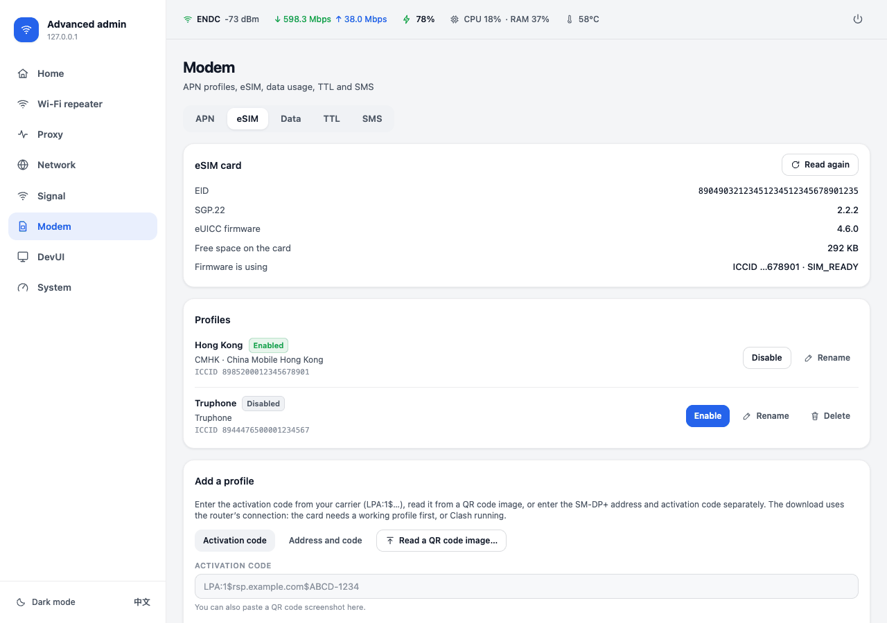<br>**eSIM**: switch, download, rename and delete profiles |
| 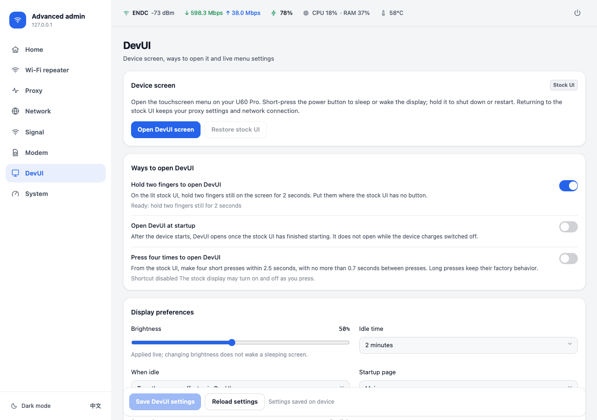<br>**DevUI**: open the touchscreen menu, ways to open it, brightness and idle | 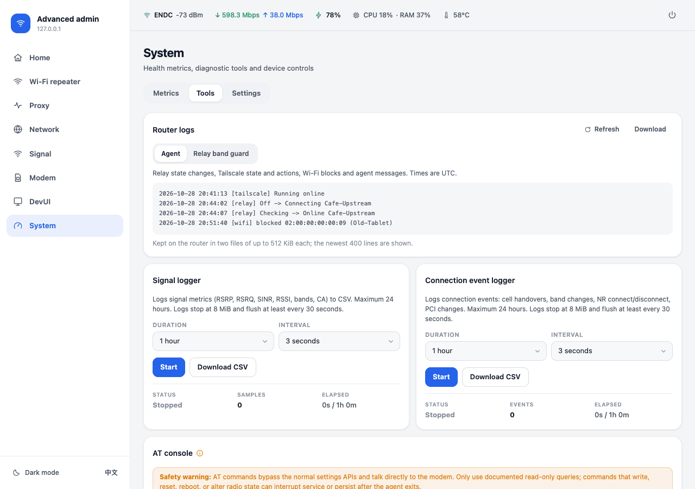<br>**System → Tools**: router log, signal and connection-event loggers |

### Touchscreen (DevUI)

<p align="center"></p>

| | | | |
| --- | --- | --- | --- |
| 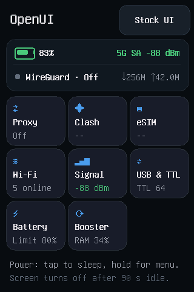<br>Main menu (3×3) | 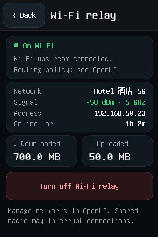<br>Wi-Fi relay | 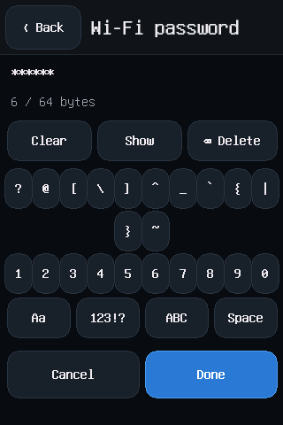<br>On-screen keyboard | 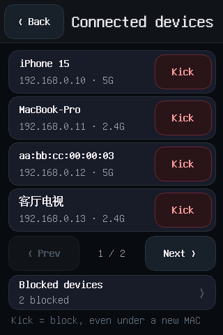<br>Connected devices, kick |
| 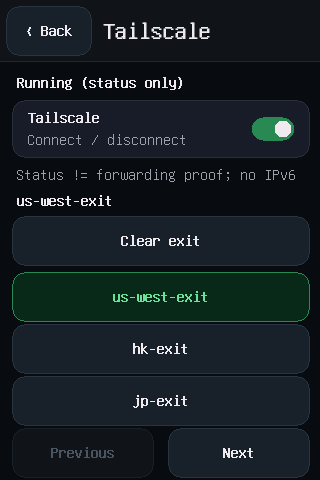<br>Tailscale exit nodes | 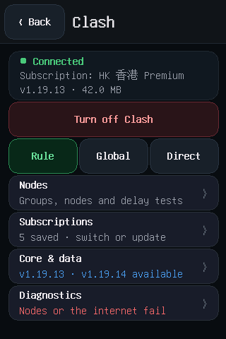<br>Clash mode and nodes | 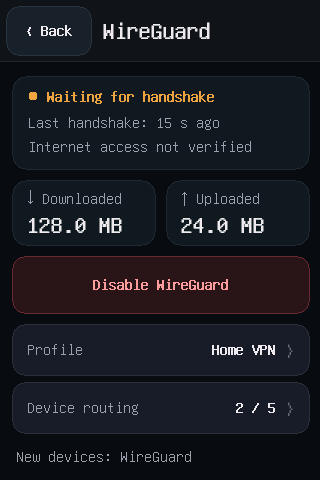<br>WireGuard | 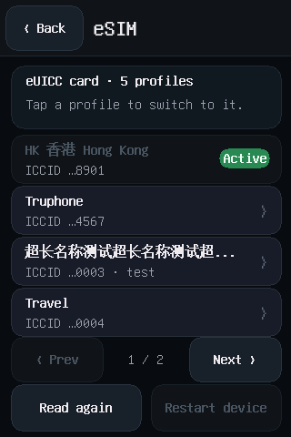<br>eSIM switching |
| 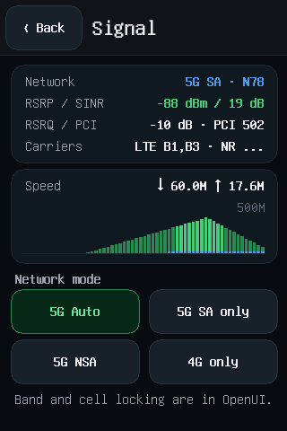<br>Signal and network mode | 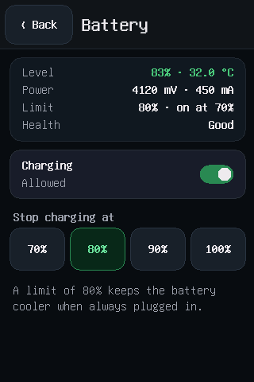<br>Battery and charge limit | 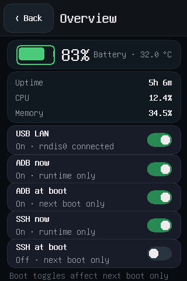<br>Overview and USB LAN | 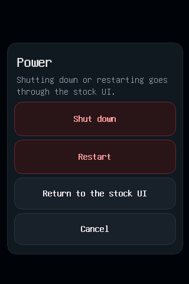<br>Power-button menu |

## Features

- **Proxy**: WireGuard, Clash or Tailscale carries traffic, one at a time; switching asks
  first and a failure restores the previous state. Each has a step-by-step setup guide.
  - **Clash**: a pinned Clash.Meta (mihomo) core and geo data are installed with
    everything else; up to five subscriptions, node groups and delay tests, rule / global
    / direct modes, per-device routing, connections and logs. See [Clash](docs/CLASH.md).
  - **WireGuard**: import your provider's `.conf`, keep several configurations, route all
    devices or chosen ones. See [WireGuard](docs/WIREGUARD.md).
  - **Tailscale** (`--with-tailscale`): sign in on the web page with a link or an auth
    key, sign out; Tailscale mode (internet through an exit node); **remote management**
    (a subnet route: reach the router and its LAN from anywhere on your tailnet, alongside
    Clash or WireGuard).
- **Wi-Fi relay**: use an existing Wi-Fi network (home, hotel, office) as the internet
  connection and save mobile data; when it drops or has no internet, traffic returns to
  cellular. Up to eight saved networks, tried in order; captive-portal logins supported.
  To avoid observed AP/STA conflicts, this fork's guard pauses the hotspot on the
  upstream's band while relaying and retains the other band. This is the current policy,
  not an absolute claim about all firmware or hardware capabilities. The guard commits
  UCI and keeps a persistent `/data` restore marker; prepare opposite-band Wi-Fi or
  USB backup management before enabling relay.
  See [Wi-Fi relay](docs/WIFI-UPLINK.md).
- **Wi-Fi and clients**: 2.4 / 5 GHz switches and transmit power; connected devices, with
  block / unblock on the web page and the touchscreen (random MACs matched by name).
- **Signal and cellular**: carrier and cell details, network mode, band and cell locks,
  APN, SMS, data usage and TTL.
- **eSIM**: manage the profiles on a removable eUICC card (9eSIM, 5ber, eSTK.me and
  similar), as EasyEUICC does on Android: switch, rename, delete, download from an
  activation code or a QR image and handle notifications on the web page; switch on the
  touchscreen. Uses lpac. See [eSIM](docs/ESIM.md).
- **Battery and system**: charge limit, temperature and resource monitoring, stopping
  vendor services and freeing memory, shutdown and restart.
- **USB**: USB LAN switch, RNDIS / ECM modes.
- **Logs and diagnostics**: rotating router log (relay, Tailscale and blocklist events),
  signal and connection-event loggers with CSV download, AT console.
- **Touchscreen menu (DevUI)**: a menu on the device's 320×480 screen in the dashboard's
  language, with up to nine features (five or more as a 3×3 grid) chosen on the web page.
  See [screen documentation](docs/SCREEN.md).
- **Checked deployment**: every deployment verifies the device and each file's checksum,
  keeps a snapshot and attempts recovery on observed deployment failures, not exact
  recovery from every possible failure. New snapshots cover current UCI/owned-sidecar
  lifecycle state; older snapshots retain legacy coverage only. See
  [rollback limits](docs/DEPLOYMENT.md#rollback-scope-and-limits).

Source review, offline/mock tests and CI do not qualify a current clean-stock B31
install, cold boot or failure recovery. Physical eSIM, relay band recovery, DevUI
supervision and Windows first install still need separate hardware evidence.

Settings are not uploaded to project servers, but both router and computer hold
private material: encrypted original recovery backups stay on the computer, and
standalone dry runs / kept work can contain decrypted configuration. The main
installer cleans temporary work on normal exit (abrupt termination may prevent it).
Never publish these materials or assume
a stock backup includes Tailscale identity. See
[privacy notes](docs/DEPLOYMENT.md#privacy-and-recovery-material).

The dashboard is in Simplified Chinese by default, with an English switch. See the
[dashboard documentation](docs/DASHBOARD.md).

## DevUI quick start

1. Open **DevUI** in the dashboard sidebar and select **Open DevUI screen**.
2. To enter on the device, hold two fingers still on the lit stock UI for 2 seconds,
   where the stock UI has no button. Two more ways are switched on in the webpage and saved:
   - **Open DevUI at startup**: opens once the stock UI has finished starting, never
     while the device charges switched off;
   - **Press four times to open DevUI**: four short power-button presses within
     2.5 seconds, with gaps no longer than 0.7 seconds.
3. Short-press the power button to sleep or wake the display; hold it for about 1.5
   seconds for the power menu: shut down, restart or return to the stock UI (shutting
   down and restarting ask once more). After the idle time (two minutes by default) the
   screen turns off and DevUI stays; you can choose to return to the stock UI instead.
4. Set brightness, idle time (30–600 seconds), what happens when idle, the startup
   page and visible menu features on the same webpage. Saving applies display and
   menu changes live; the startup page applies the next time DevUI opens.

The two-finger hold is on by default; opening at startup and the four-press shortcut
are off. The stock lock screen does not stop the two-finger hold or the four presses.
**Stock UI** and **Back** (top left) are always on screen. Leaving DevUI does not affect
the network.

## Device

| **Model** | ZTE U60 Pro (MU5250) |
| --- | --- |
| **Hardware** | `MU5250_HW1.0` |
| **Firmware** | `CN_ZTE_MU5250V1.0.0B31` |
| **Chipset** | Qualcomm Snapdragon X75 (SDX75 / SDXPINN), 4× Cortex-A55 @ 2.2 GHz |

These are the details of the device the project is developed on. They do not establish
compatibility with other models, hardware revisions or firmware.

## Updating

- **macOS / Linux**: `bash install.sh --update`.
- **Windows**: double-click `deploy-windows.cmd` in the repository. It updates a device
  that already runs OpenUI with SSH on port 2222 to the release matching the checkout
  (agent, dashboard, touchscreen, lpac and Clash core) and keeps the password. Options:
  `Get-Help .\scripts\windows\deploy.ps1 -Detailed`. A first install from Windows is
  untested.

Do not use upstream's desktop installer (Open U60 Pro Installer): it installs the
upstream release and overwrites this fork's additions. This fork has no qualified
desktop distribution; old GUI / `setup.sh` tutorials are superseded by `install.sh`.

Each [release](https://github.com/wgltony/U60Pro-OpenUI/releases) lists its files and
their SHA-256 checksums.

<details>
<summary><b>Build from source and deploy by hand</b></summary>

`bash install.sh --from-source` builds every component on your computer, then installs.
It needs:

- Rust with the `aarch64-unknown-linux-musl` target, and `cargo-zigbuild`;
- Zig 0.14.1; both the installer and manual build use `cargo zigbuild`, not an
  additional musl cross-GCC linker;
- Python 3;
- Node.js `^20.19.0 || >=22.12.0` with npm;
- Go or Docker for the Clash core.

Or build by hand:

```sh
cargo zigbuild --locked --release -p zte-agent --target aarch64-unknown-linux-musl
(cd web-app && npm ci && npm run build)
mkdir -p build && tar czf build/dashboard-dist.tar.gz -C web-app/dist .
ZIG=/path/to/zig sh screen/build.sh
ZIG=/path/to/zig python3 scripts/prepare-lpac.py
python3 scripts/prepare-mihomo.py
python3 scripts/prepare-geodata.py
python3 scripts/prepare-wireguard.py
python3 scripts/prepare-tailscale.py      # optional
```

The screen program, lpac, Clash core, WireGuard tool and Tailscale downloads are all
checksum-pinned. None of these commands contacts or changes your device.

Deploy to a device that already runs OpenUI with `deploy-components.py`:

```sh
python3 scripts/deploy-components.py \
  --gateway 192.168.0.1 \
  --ssh-key ~/.ssh/id_ed25519 \
  --agent target/aarch64-unknown-linux-musl/release/zte-agent \
  --dashboard build/dashboard-dist.tar.gz \
  --screen build/screen/openui-screen \
  --lpac build/lpac/lpac \
  --mihomo build/mihomo/mihomo --mihomo-geodata build/mihomo/geo \
  --wireguard-tools build/wireguard/wg \
  --keep-credentials --skip-unchanged \
  --dry-run
```

- `--keep-credentials` keeps the agent password and PIN the device already has.
- `--skip-unchanged` leaves out components already installed at the same checksum.
- Review the dry run, then repeat without `--dry-run`. Restore the stock screen before
  replacing the screen program.
- A new screen program must pass a supervised check (about three minutes) before the web
  page's screen entry opens:
  `python3 scripts/verify-screen.py --gateway 192.168.0.1 --port 2222 --ssh-key ~/.ssh/id_ed25519`.

See [Deployment](docs/DEPLOYMENT.md) and [Screen](docs/SCREEN.md) for the other options.

</details>

<details>
<summary><b>Local demo and checks</b></summary>

No device needed. Run these in two terminals:

```sh
python3 web-app/tools/mock_agent.py --port 19090 --wireguard-demo
```

```sh
cd web-app
npm ci
npm run demo
```

Open the Vite URL and sign in with any nonempty password. Both servers stay on loopback;
the mock keeps its data in memory.

```sh
cargo test --locked -p zte-agent -p process-runner
python3 -m unittest discover -s tests -v
python3 scripts/check-api-contract.py
python3 scripts/check-device-secrets.py
(cd web-app && npm run build && npm run lint && npm test)
sh screen/build.sh --preview      # touchscreen preview and self-tests; renders in build/screen/
```

</details>

## Documentation

- [Install guide](docs/INSTALL.md) / [安装教程](docs/INSTALL.zh.md)
- [Enabling ADB](docs/ADB.md) / [开启 ADB](docs/ADB.zh.md): how to re-enable ADB on stock B31
- [Deployment](docs/DEPLOYMENT.md), [Safety](docs/SAFETY.md), [Dashboard](docs/DASHBOARD.md),
  [Touchscreen](docs/SCREEN.md), [Clash](docs/CLASH.md), [WireGuard](docs/WIREGUARD.md),
  [Wi-Fi relay](docs/WIFI-UPLINK.md), [eSIM](docs/ESIM.md), [Agent API](docs/AGENT.md),
  [Operations](docs/OPERATIONS.md)

## Acknowledgements

- [acloudpeng/U60Pro-OpenUI](https://github.com/acloudpeng/U60Pro-OpenUI): this fork's upstream.
- [dklasens/MU5250-OpenUI](https://github.com/dklasens/MU5250-OpenUI): the OpenUI
  backend, dashboard, installer and deployment foundation.
- [ZweiChen](https://github.com/czwstc): the fork upstream continues, including the
  bilingual touchscreen menu.
- [jesther-ai/open-u60-pro](https://github.com/jesther-ai/open-u60-pro): the original
  open U60 project and the device access work that OpenUI is based on.
- [amenekowo/mu5250_tweaking](https://github.com/amenekowo/mu5250_tweaking): MU5250
  hardware research, and the Atomic DRM example used for the touchscreen panel.
- [33333s/u60pro-devui](https://github.com/33333s/u60pro-devui): the HTML/CSS RGB565
  renderer used by the DevUI menu.
- [scoltzero/u60pro-devui-remix](https://github.com/scoltzero/u60pro-devui-remix): a
  reference for device controls in the touchscreen menu.
- [estkme-group/lpac](https://github.com/estkme-group/lpac) and
  [OpenEUICC](https://gitea.angry.im/PeterCxy/OpenEUICC): the eSIM LPA this project
  runs, and the app whose features its eSIM page follows.
- [SadykovIV/ZTE_U60Pro](https://github.com/SadykovIV/ZTE_U60Pro): the eSIM switching
  sequence verified on B31.
- [Clash.Meta / mihomo](https://github.com/chen08209/Clash.Meta),
  [Tailscale](https://github.com/tailscale/tailscale), [WireGuard](https://www.wireguard.com/),
  and litehtml, FreeType and GNU Unifont.

Original author and license notices are preserved. This repository includes no ZTE
firmware, private configuration or original reference archive.

## Copyright and licenses

Each part keeps its authors' copyright:
- OpenUI: David Klasens and Jesther Silvestre;
- the fork upstream continues: ZweiChen;
- upstream's additions: acloudpeng;
- this fork's additions: wgltony.

| Component | License |
| --- | --- |
| OpenUI agent, dashboard and general tooling | [MIT](LICENSE), preserving David Klasens and Jesther Silvestre notices |
| Separate native screen program and adapted DRM code | [GPL-3.0-or-later](screen/LICENSE) |
| Embedded GNU Unifont OTF | [SIL Open Font License 1.1](screen/FONT-LICENSE) |
| lpac, the separate eSIM program | [AGPL-3.0-only](licenses/lpac/), with libeuicc LGPL-2.1-only and cJSON MIT |
| mihomo, the separate Clash core | GPL-3.0; source at [chen08209/Clash.Meta](https://github.com/chen08209/Clash.Meta) plus `scripts/mihomo-patches/` |
| Dependencies and downloaded tools | Their respective upstream licenses |

See [NOTICE](NOTICE), the [screen notices](screen/NOTICE) and the [preserved upstream
licenses](licenses/). The root MIT license does not relicense the GPL screen code or
third-party fonts. Distributing the GPL screen executable requires its corresponding
source and the applicable notices; the screen source and build scripts are in this
repository.
