# U60Pro-OpenUI

简体中文 | [繁體中文](README.zh-TW.md) | [English](README.en.md)

**中兴 U60 Pro（MU5250，CN B31 固件）** 的第三方界面：一个网页控制台和一个触摸屏菜单（DevUI），
在原厂固件之上加入 Clash / WireGuard / Tailscale 代理、无线中继、eSIM 管理、Wi-Fi 客户端管理等功能。
满足下列前提后，可用主安装脚本安装；不等于已完成当前版本的干净原厂机验收。

本仓库是 [acloudpeng/U60Pro-OpenUI](https://github.com/acloudpeng/U60Pro-OpenUI) 的分支，
延续 [MU5250-OpenUI](https://github.com/dklasens/MU5250-OpenUI) 以及[致谢](#致谢)中列出的工作。

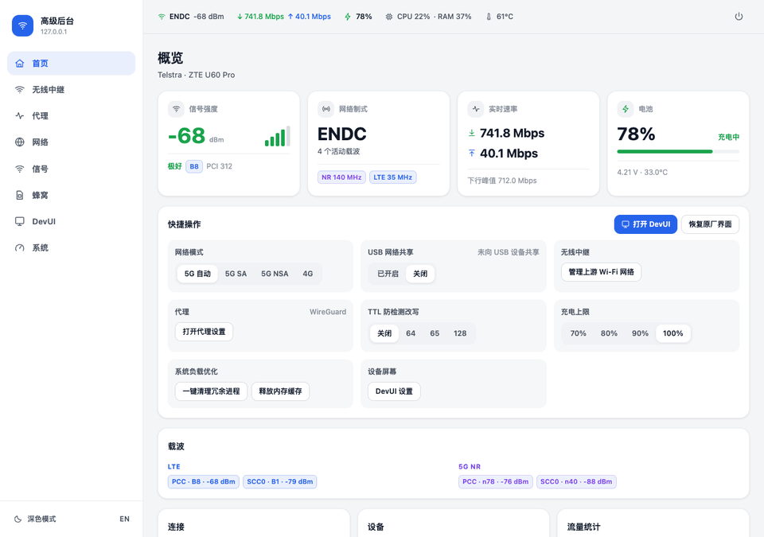

| 服务 | 地址 |
| --- | --- |
| 网页控制台 | `http://192.168.0.1:8080/` |
| 需要登录的 API | `http://192.168.0.1:9090/` |
| SSH（只认密钥） | `ssh -p 2222 root@192.168.0.1` |

> [!WARNING]
> 只在 `MU5250_HW1.0` + `CN_ZTE_MU5250V1.0.0B31` 上测试过。安装会开启 ADB、关闭固件自动更新，
> 并改动设备的启动脚本。动手之前请先读 [安全说明](docs/SAFETY.md)（英文）。

## 一条命令安装

需要一台 Mac 或 Linux 电脑。**锁定 B31 首装必须连接 USB 数据线，并能通过网络访问路由器**（Wi-Fi 有助于保持网络连接）；只连 Wi-Fi 不够。已有 root SSH 的更新可以只走 Wi-Fi。

**下载安装文件前**，先取得路由器管理员密码和外部提供的备份密钥后缀。仓库不提供后缀；可向[支持渠道](https://github.com/wgltony/U60Pro-OpenUI/issues)询问当前获取指引，不要公开后缀或备份。无法取得就先停止；已知 B31 不能用简单 `strings` 提取，离线工具也不能代为取得。

```bash
git clone https://github.com/wgltony/U60Pro-OpenUI.git
cd U60Pro-OpenUI
bash install.sh --dry-run     # 先试运行，不写入设备；会下载并生成本机材料
bash install.sh               # 安装；加 --with-tailscale 同时安装 Tailscale
```

脚本会检查电脑上的工具，下载本仓库的发布文件并校验，设备还锁着时先开启 ADB（需要路由器管理员密码和备份密钥后缀），
然后通过带快照及失败恢复尝试的部署装好下面所有功能。逐步说明和常见问题见 [安装教程](docs/INSTALL.zh.md)。

锁定首装恢复前，交互运行必须输入 `YES` 确认 USB 数据线已接到本机；非交互运行须显式加 `--acknowledge-usb`。空的 `adb devices` 列表不是接线证明；若有多台设备，用 `--adb-serial` 指定，等待及部署都沿用该选择。

以后更新：`bash install.sh --update`（保留密码，跳过没变的部分）。

## 界面一览

截图都来自仓库自带的演示数据（`web-app/tools/mock_agent.py` 和触摸屏的预览构建），不含真实设备信息。

### 网页控制台

| | |
| --- | --- |
| 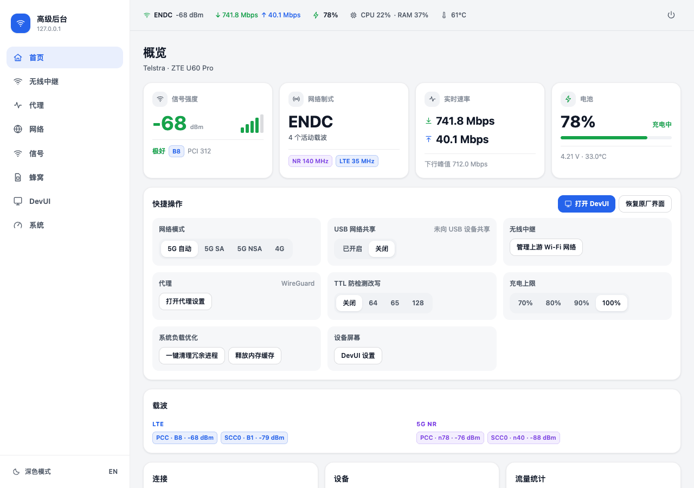<br>**首页**：信号、速率、电池、载波和快捷操作 | 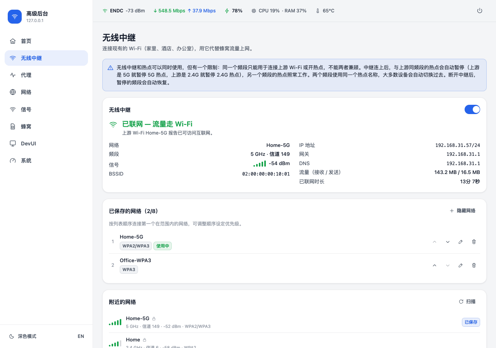<br>**无线中继**：连接上游 Wi-Fi、保存多个网络、扫描附近网络 |
| 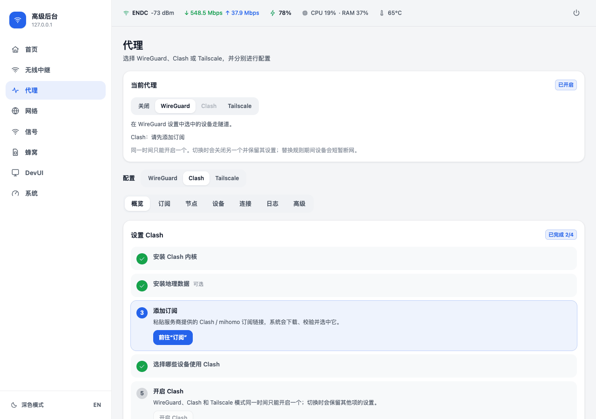<br>**Clash**：分步设置向导、订阅、节点、按设备分流 | 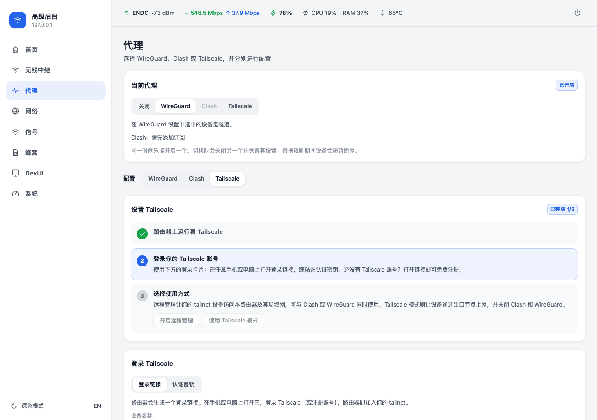<br>**Tailscale**：网页上登录、出口节点、远程管理 |
| 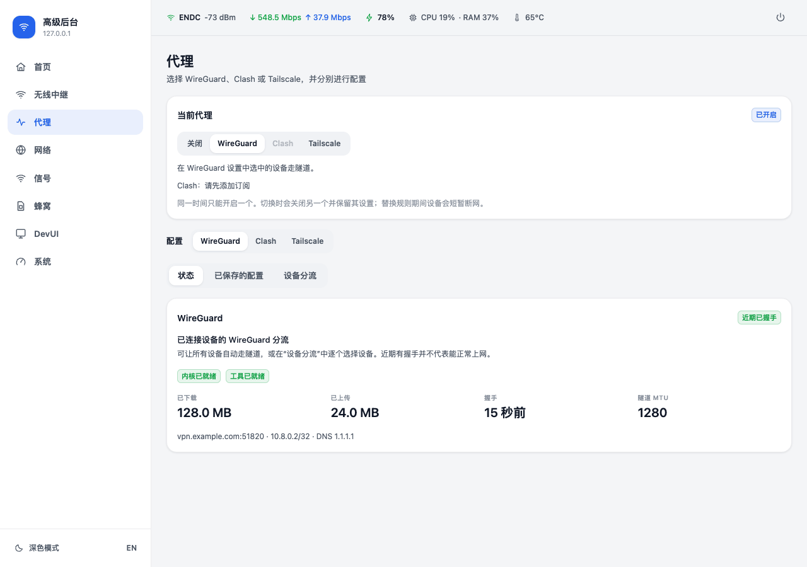<br>**WireGuard**：导入配置、按设备分流、隧道状态 | 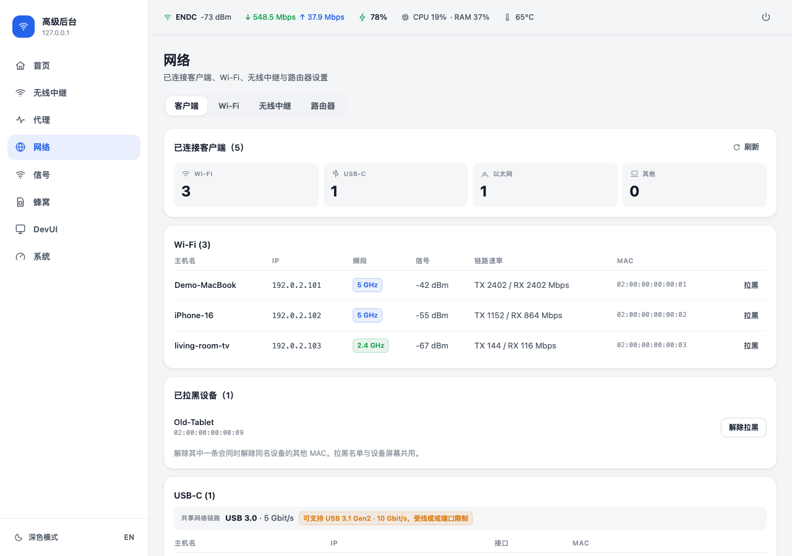<br>**客户端**：Wi-Fi / USB / 网线设备，一键拉黑和解除 |
| 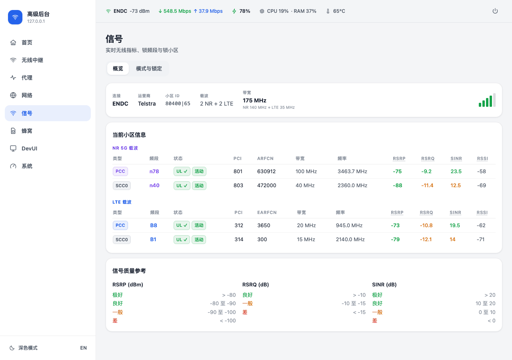<br>**信号**：5G / LTE 载波、小区信息、频段与小区锁定 | 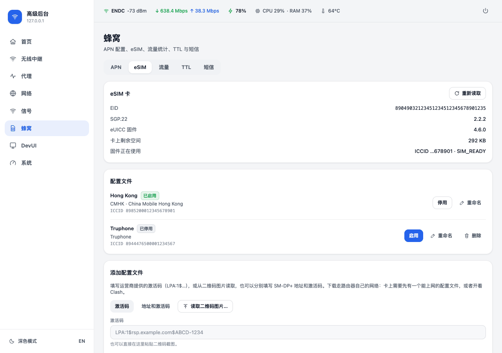<br>**eSIM**：切换、下载、重命名、删除配置文件 |
| 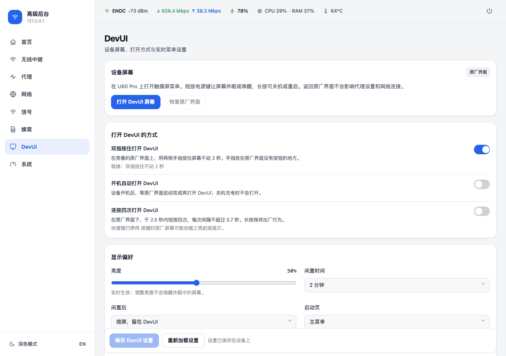<br>**DevUI**：打开触摸屏菜单、打开方式、亮度和闲置设置 | 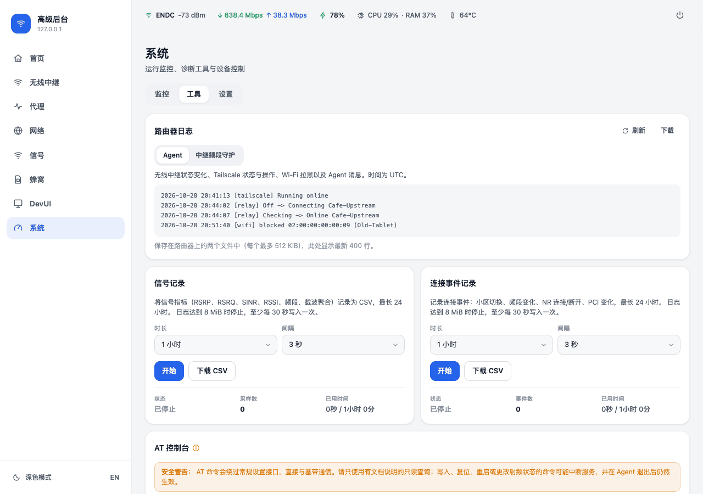<br>**系统 → 工具**：路由器日志、信号与连接事件记录 |

### 触摸屏（DevUI）

<p align="center"></p>

| | | | |
| --- | --- | --- | --- |
| 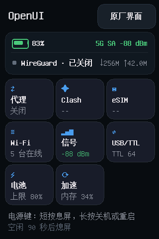<br>主菜单（九宫格） | 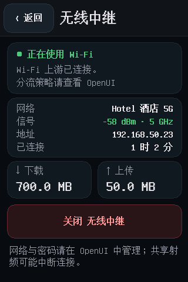<br>无线中继 | 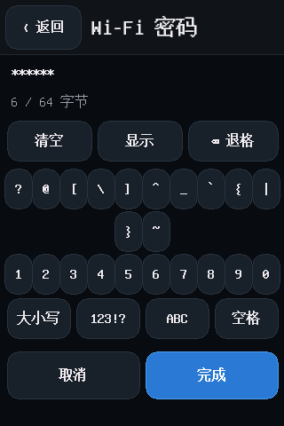<br>屏幕键盘输入密码 | 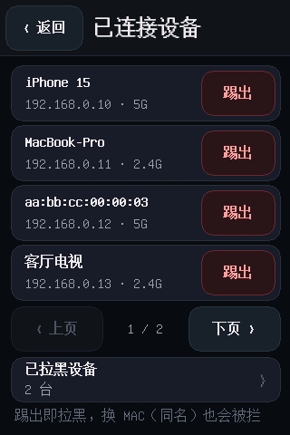<br>已连接设备与踢出 |
| 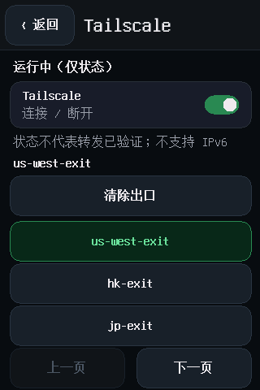<br>Tailscale 出口节点 | 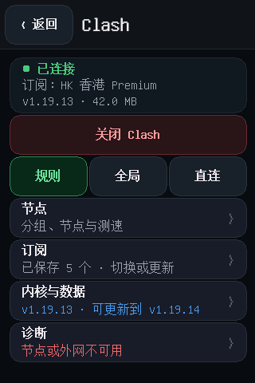<br>Clash 模式与节点 | 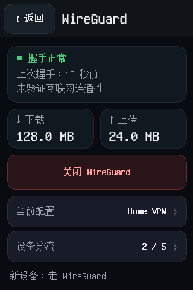<br>WireGuard | 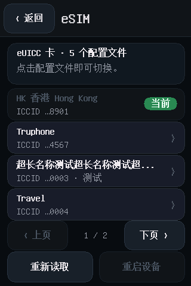<br>eSIM 切换 |
| 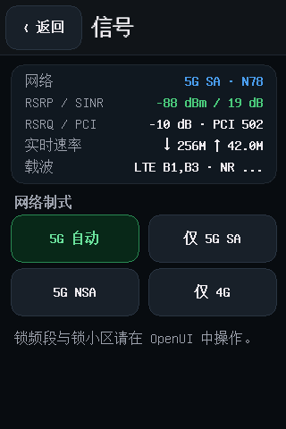<br>信号与网络制式 | 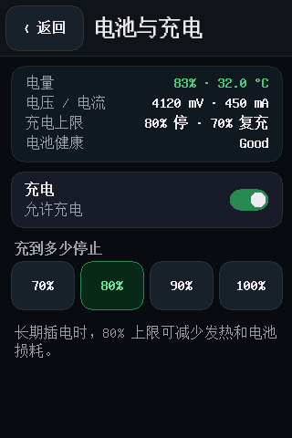<br>电池与充电上限 | 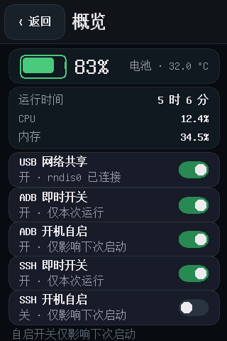<br>概览与 USB 网络共享 | 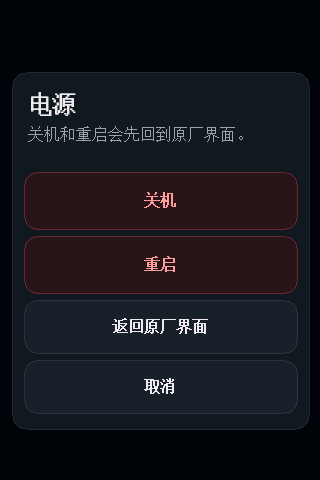<br>长按电源键菜单 |

## 功能

- **代理**：WireGuard、Clash、Tailscale 三选一转发流量，切换前确认，失败自动恢复原状。每种都有分步设置向导。
  - **Clash**：固定版本的 Clash.Meta（mihomo）内核和地理数据随安装一起部署；最多 5 个订阅，节点分组与测速，
    规则 / 全局 / 直连，按设备分流，连接和日志查看。见 [Clash 文档](docs/CLASH.md)。
  - **WireGuard**：导入服务商的 `.conf`，保存多个配置，所有设备或指定设备走隧道。见 [WireGuard 文档](docs/WIREGUARD.md)。
  - **Tailscale**（`--with-tailscale`）：在网页上用登录链接或认证密钥登录、退出；Tailscale 模式（经出口节点上网）；
    **远程管理**（子网路由，在任何地方通过 tailnet 访问路由器和局域网，可与 Clash / WireGuard 同时使用）。
- **无线中继**：连上已有的 Wi-Fi（家里、酒店、办公室）当作上网通道，省下蜂窝流量；上游断开或不能上网时自动回到蜂窝网络。
  可保存 8 个网络按顺序连接，支持需要网页认证的热点。
  本分支为规避已观测到的 AP/STA 冲突，中继时由守护暂停与上游同频段的热点，保留另一频段；这是当前策略，不是对所有固件或硬件能力的绝对结论。守护会提交 UCI，并在 `/data` 留持久恢复标记；开启前准备另一频段或 USB 备用管理通道。
  见 [Wi-Fi 中继文档](docs/WIFI-UPLINK.md)。
- **Wi-Fi 与客户端**：2.4G / 5G 开关、发射功率；查看已连接设备，在网页或触摸屏上拉黑 / 解除拉黑（按设备名识别随机 MAC）。
- **信号与蜂窝**：载波和小区详情、网络制式、频段与小区锁定、APN、短信、流量统计、TTL。
- **eSIM**：管理 SIM 卡槽里可插拔 eUICC 卡（9eSIM、5ber、eSTK.me 等）上的配置文件，功能对标 Android 上的 EasyEUICC：
  网页上切换、重命名、删除，用激活码或二维码图片下载，处理通知；触摸屏上切换。基于 lpac。见 [eSIM 文档](docs/ESIM.md)。
- **电池与系统**：充电上限、温度和资源监控、清理厂商服务和释放内存、关机和重启。
- **USB**：USB 网络共享开关，RNDIS / ECM 模式切换。
- **日志与诊断**：路由器滚动日志（中继、Tailscale、拉黑事件），信号记录和连接事件记录（CSV 下载），AT 控制台。
- **触摸屏菜单（DevUI）**：设备 320×480 屏幕上的菜单，语言跟随网页。最多显示九个功能（五个以上排成九宫格），
  在网页上选择显示哪些。见[屏幕文档](docs/SCREEN.md)。
- **有校验的部署**：核对设备身份和文件校验和，保留快照并在观测到部署失败时尝试恢复；不是任何失败都精确恢复的保证。新快照包含当前 UCI / 自有 sidecar 生命周期覆盖，旧快照只有旧覆盖范围，见[回退边界](docs/DEPLOYMENT.md#rollback-scope-and-limits)。

源码、离线 / mock 测试与 CI 不等于当前干净原厂 B31 的首装、冷启动、故障恢复验收；实体 eSIM、无线频段恢复、DevUI 监督和 Windows 首装仍需各自的实机证据。

配置不会上传项目服务器，但路由器与电脑都含私密材料：电脑保留加密原始恢复备份，独立 dry-run / 保留工作目录可能留下解密配置；主安装器正常退出时清理临时目录（异常终止可能来不及清理）。不要公开这些材料，也不要假设原厂备份含 Tailscale 身份。详见[隐私说明](docs/DEPLOYMENT.md#privacy-and-recovery-material)。

网页默认简体中文，可切换为英文。见[控制台文档](docs/DASHBOARD.md)。

## DevUI 快速上手

1. 在控制台侧栏打开 **DevUI**，点击 **打开 DevUI 屏幕**。
2. 在设备上直接进入：原厂界面亮着时，用两根手指按住屏幕不动 2 秒，手指放在原厂界面没有按钮的地方。
   另外两种方式要在网页上打开并保存：
   - **开机自动打开 DevUI**：开机后等原厂界面启动完成再打开，关机充电时不会打开；
   - **连按四次打开 DevUI**：2.5 秒内短按四次电源键，每两次之间不超过 0.7 秒。
3. 短按电源键让屏幕休眠或唤醒；长按约 1.5 秒弹出电源菜单，可关机、重启或返回原厂界面（关机和重启会再确认一次）。
   闲置到设定的时间（默认 2 分钟）后屏幕熄灭，DevUI 保留；也可以改成返回原厂界面。
4. 亮度、闲置时间（30–600 秒）、闲置后的操作、启动页和菜单功能都在同一个网页上设置。保存后显示和菜单立即生效，
   启动页在下次打开 DevUI 时生效。

双指按住默认开启，开机打开和连按快捷方式默认关闭。原厂锁屏挡不住双指按住和连按：锁屏时这样操作，同样会打开 DevUI。
屏幕上始终有 **原厂界面** 和 **返回**（左上角）。退出 DevUI 不影响网络。

## 设备

| **型号** | 中兴 U60 Pro（MU5250） |
| --- | --- |
| **硬件** | `MU5250_HW1.0` |
| **固件** | `CN_ZTE_MU5250V1.0.0B31` |
| **芯片** | 高通骁龙 X75（SDX75 / SDXPINN），4 × Cortex-A55 @ 2.2 GHz |

以上是开发所用设备的信息，不代表兼容其他型号、硬件版本或固件。

## 更新

- **macOS / Linux**：`bash install.sh --update`。
- **Windows**：双击仓库里的 `deploy-windows.cmd`。它把已经装好、在 2222 端口开着 SSH 的设备更新到与仓库版本对应的发布版本
  （agent、网页、触摸屏、lpac 和 Clash 内核），保留原来的密码。选项见 `Get-Help .\scripts\windows\deploy.ps1 -Detailed`。
  用 Windows 第一次安装没有测试过。

不要使用上游的桌面安装器（Open U60 Pro Installer）：它安装的是上游版本，会覆盖本分支新增的功能。本分支没有经过验收的桌面分发；旧 GUI / `setup.sh` 教程均以当前 `install.sh` 为准。

每个[发布版本](https://github.com/wgltony/U60Pro-OpenUI/releases)都列出文件及其 SHA-256 校验和。

<details>
<summary><b>从源码构建和手动部署</b></summary>

`bash install.sh --from-source` 会在本机构建全部组件再安装。需要：

- Rust，带 `aarch64-unknown-linux-musl` 目标，以及 `cargo-zigbuild`；
- Zig 0.14.1；主安装脚本与手动构建均使用 `cargo zigbuild`，不要求另装 musl 交叉 GCC；
- Python 3；
- Node.js `^20.19.0 || >=22.12.0` 和 npm；
- Clash 内核需要 Go 或 Docker。

也可以手动构建：

```sh
cargo zigbuild --locked --release -p zte-agent --target aarch64-unknown-linux-musl
(cd web-app && npm ci && npm run build)
mkdir -p build && tar czf build/dashboard-dist.tar.gz -C web-app/dist .
ZIG=/path/to/zig sh screen/build.sh
ZIG=/path/to/zig python3 scripts/prepare-lpac.py
python3 scripts/prepare-mihomo.py
python3 scripts/prepare-geodata.py
python3 scripts/prepare-wireguard.py
python3 scripts/prepare-tailscale.py      # 可选
```

屏幕程序、lpac、Clash 内核、WireGuard 工具和 Tailscale 的下载都固定了校验和。这些命令都不会连接或改动你的设备。

用 `deploy-components.py` 部署到已经装好 OpenUI 的设备：

```sh
python3 scripts/deploy-components.py \
  --gateway 192.168.0.1 \
  --ssh-key ~/.ssh/id_ed25519 \
  --agent target/aarch64-unknown-linux-musl/release/zte-agent \
  --dashboard build/dashboard-dist.tar.gz \
  --screen build/screen/openui-screen \
  --lpac build/lpac/lpac \
  --mihomo build/mihomo/mihomo --mihomo-geodata build/mihomo/geo \
  --wireguard-tools build/wireguard/wg \
  --keep-credentials --skip-unchanged \
  --dry-run
```

- `--keep-credentials`：保留设备上现有的 agent 密码和 PIN。
- `--skip-unchanged`：跳过设备上已有、校验和相同的组件。
- 先看试运行的结果，没问题再去掉 `--dry-run`。替换屏幕程序之前，先让屏幕回到原厂界面。
- 新的屏幕程序要先通过一次有人值守的检查（约三分钟），网页上的屏幕入口才会开放：
  `python3 scripts/verify-screen.py --gateway 192.168.0.1 --port 2222 --ssh-key ~/.ssh/id_ed25519`。

其他选项见 [部署文档](docs/DEPLOYMENT.md) 和 [屏幕文档](docs/SCREEN.md)（英文）。

</details>

<details>
<summary><b>本地演示和检查</b></summary>

不需要设备。分别在两个终端里运行：

```sh
python3 web-app/tools/mock_agent.py --port 19090 --wireguard-demo
```

```sh
cd web-app
npm ci
npm run demo
```

打开 Vite 给出的地址，用任意非空密码登录。两个服务都只监听本机，模拟数据只在内存里。

```sh
cargo test --locked -p zte-agent -p process-runner
python3 -m unittest discover -s tests -v
python3 scripts/check-api-contract.py
python3 scripts/check-device-secrets.py
(cd web-app && npm run build && npm run lint && npm test)
sh screen/build.sh --preview      # 触摸屏的本机预览和自测，渲染图在 build/screen/
```

</details>

## 文档

- [安装教程](docs/INSTALL.zh.md)（中文）/ [Install guide](docs/INSTALL.md)
- [开启 ADB](docs/ADB.zh.md)（中文）/ [Enabling ADB](docs/ADB.md)：原厂 B31 开启 ADB 的原理和步骤
- 以下为英文：[部署](docs/DEPLOYMENT.md)、[安全](docs/SAFETY.md)、[控制台](docs/DASHBOARD.md)、[触摸屏](docs/SCREEN.md)、
  [Clash](docs/CLASH.md)、[WireGuard](docs/WIREGUARD.md)、[Wi-Fi 中继](docs/WIFI-UPLINK.md)、[eSIM](docs/ESIM.md)、
  [Agent API](docs/AGENT.md)、[操作手册](docs/OPERATIONS.md)

## 致谢

- [acloudpeng/U60Pro-OpenUI](https://github.com/acloudpeng/U60Pro-OpenUI)：本分支的上游。
- [dklasens/MU5250-OpenUI](https://github.com/dklasens/MU5250-OpenUI)：OpenUI 的后端、控制台、安装器和部署基础。
- [ZweiChen](https://github.com/czwstc)：上游延续的分支，包括中英文触摸屏菜单。
- [jesther-ai/open-u60-pro](https://github.com/jesther-ai/open-u60-pro)：最初的 U60 开源项目，以及 OpenUI 所依赖的设备访问工作。
- [amenekowo/mu5250_tweaking](https://github.com/amenekowo/mu5250_tweaking)：MU5250 硬件研究，以及触摸屏面板使用的 Atomic DRM 示例。
- [33333s/u60pro-devui](https://github.com/33333s/u60pro-devui)：DevUI 菜单使用的 HTML/CSS RGB565 渲染器。
- [scoltzero/u60pro-devui-remix](https://github.com/scoltzero/u60pro-devui-remix)：触摸屏菜单中设备控制的参考。
- [estkme-group/lpac](https://github.com/estkme-group/lpac) 和 [OpenEUICC](https://gitea.angry.im/PeterCxy/OpenEUICC)：
  本项目运行的 eSIM LPA，以及 eSIM 页面所参照的应用。
- [SadykovIV/ZTE_U60Pro](https://github.com/SadykovIV/ZTE_U60Pro)：在 B31 上验证过的 eSIM 切换流程。
- [Clash.Meta / mihomo](https://github.com/chen08209/Clash.Meta)、[Tailscale](https://github.com/tailscale/tailscale)、
  [WireGuard](https://www.wireguard.com/)，以及 litehtml、FreeType 和 GNU Unifont。

原作者和许可证声明都已保留。本仓库不包含中兴固件、私人配置或原始参考压缩包。

## 版权和许可证

各部分的版权归各自作者：
- OpenUI：David Klasens 和 Jesther Silvestre；
- 上游延续的分支：ZweiChen；
- 上游新增的内容：acloudpeng；
- 本分支新增的内容：wgltony。

| 组件 | 许可证 |
| --- | --- |
| OpenUI agent、控制台和通用工具 | [MIT](LICENSE)，保留 David Klasens 和 Jesther Silvestre 的声明 |
| 单独构建的屏幕程序和改编的 DRM 代码 | [GPL-3.0-or-later](screen/LICENSE) |
| 内嵌的 GNU Unifont OTF 字体 | [SIL Open Font License 1.1](screen/FONT-LICENSE) |
| lpac（单独的 eSIM 程序） | [AGPL-3.0-only](licenses/lpac/)，其中 libeuicc 为 LGPL-2.1-only，cJSON 为 MIT |
| Clash 内核 mihomo（单独的程序） | GPL-3.0，源码见 [chen08209/Clash.Meta](https://github.com/chen08209/Clash.Meta) 和 `scripts/mihomo-patches/` |
| 依赖和下载的工具 | 各自上游的许可证 |

见 [NOTICE](NOTICE)、[屏幕程序声明](screen/NOTICE)和[保留的上游许可证](licenses/)。根目录的 MIT 许可证不会改变 GPL 屏幕代码或第三方字体的许可。
分发 GPL 屏幕程序时，必须附带对应的源码和相关声明；屏幕程序的源码和构建脚本都在本仓库里。
